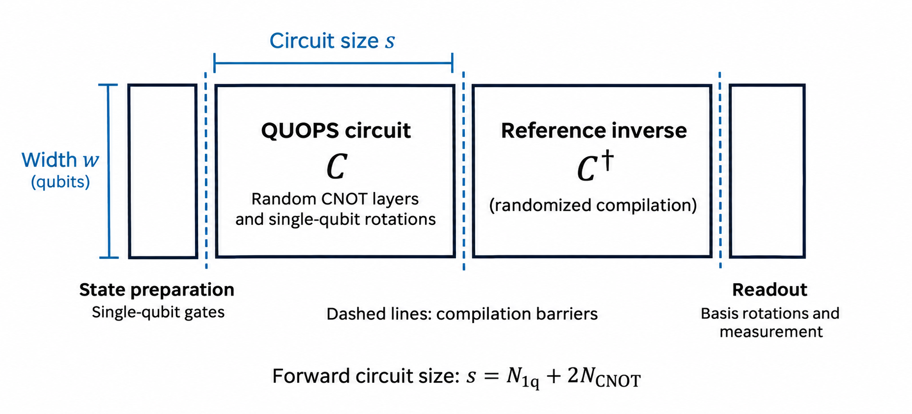

# QUOPS with CUDA-Q

QUOPS measures the scale of quantum computation a system can sustain at a defined accuracy, and the rate at which it performs that computation:

- **Capability:** the largest eligible circuit size demonstrated to meet the accuracy threshold.
- **Throughput, QUOPS/s:** the execution rate at a stated circuit size, weighted by measured accuracy.

The benchmark tests arbitrary single-qubit rotations and entangling gates. Results reflect gates, connectivity, compilation and execution together. Application performance still depends on circuit structure. See [*Benchmarking the computational power of quantum computers*](https://arxiv.org/html/2609.12146v1) for the definitions and physical/logical experiments.

## Run the notebook

Use **Linux x86-64 with Python 3.12**. The default target is `density-matrix-cpu`; no GPU is required. From this directory:

```bash
python3.12 -m venv .venv
source .venv/bin/activate
python -m pip install -r requirements.txt
python -m pip check
python -m ipykernel install --sys-prefix --name quops --display-name "Python (QUOPS)"
python -m jupyterlab quops.ipynb
```

Select **Python (QUOPS)** and run the cells in order. Keep `src.py` and `plots/` beside the notebook. Let acquisition and `save_notebook_evidence()` finish before analysis. Each run saves raw counts, targets, observations and settings in a new directory under `results/`.

| File | Purpose |
| --- | --- |
| [quops.ipynb](quops.ipynb) | Main simulation and analysis workflow. |
| [src.py](src.py) | Circuit generation, randomized compilation, analysis, plotting and result storage. |
| [requirements.txt](requirements.txt) | Pinned direct dependencies and Jupyter tools. |
| [logical_quops.ipynb](logical_quops.ipynb) | Separate introduction to CUDA-Q Logical. |

## Understand the circuit

The forward circuit alternates random CNOT pairings with random single-qubit rotations. Width sets the number of qubits; depth sets the number of elementary layers. Each shape is tested with multiple random circuits and repeated shots.



The forward circuit uses the compiler being evaluated. The reference inverse uses randomized compilation; paired endpoint rotations give a known ideal output. The notebook acquires BR, RR and REF ensembles to estimate forward-circuit accuracy and account for reference and preparation/readout effects.

- **Size:** count each source rotation once and each source CNOT twice, before device compilation. Reference circuits and verification overhead do not increase this size.
- **Depth:** use an even number of elementary layers, with `depth / 2` CNOT/rotation pairs. A full six-qubit circuit at depth 10 has 30 rotations and 15 CNOTs: size **60**.
- **Eligibility:** the QUOPS score uses shapes within `w² ≤ size ≤ w³`; the notebook selects eligible shapes.
- **Compilation boundaries:** preserve preparation, forward, reference and readout segments, including internal reference layers. Cross-boundary optimization can cancel the workload and invalidate verification. Provider integration must enforce these boundaries through final lowering. [Paper §II.C](https://arxiv.org/html/2609.12146v1#S2.SS3)

## Run QUOPS on hardware

1. **Check the environment.** Run the supplied simulation example and identify the gate-based QPU to benchmark.
2. **Model the backend.** Replace the illustrative noise model with provider or calibration-informed gate and readout errors. Account for connectivity and routing. Simulate the full BR/RR/REF workload.
3. **Find candidate shapes.** Start small, increase width and depth, and sample more densely near the predicted pass boundary. Allow margin for model uncertainty and include a smaller fallback. Simulation guides selection; its resource limit is not the QPU's limit.
4. **Fix the confirmation plan.** Declare shapes, independent circuits, mirrors, shots, seeds, compilation settings and error budget before acquisition. Use fresh independent circuit instances and hardware data. Complete the plan; do not stop when a result first passes.
5. **Configure the QPU.** Use `cudaq.set_target(...)` with provider credentials and the intended device/project/endpoint. Confirm that it selects hardware, not an emulator or syntax checker. Replace `noise = make_helios1_noise()` with **`noise = None`**. [CUDA-Q hardware setup](https://nvidia.github.io/cuda-quantum/0.16.0/using/backends/hardware.html)
6. **Acquire and analyze.** Run the full verification sequence and use the notebook's adjusted pass decisions. Report non-passes; use a planned fallback or a new confirmation run with an appropriate statistical plan.
7. **Measure throughput.** After demonstrating capability, optimize shot batches at the selected shape and confirm that it still passes. Report the circuit size with the rate. [Paper §VIII](https://arxiv.org/html/2609.12146v1#S8)

### Compilation and acquisition

- Optimize forward layout, routing and native gates before mirror assembly; retain the original fidelity target. For standard physical MCFE, compile and route references exactly before Pauli randomization. Document any architecture-required exceptions to the compilation rules. [Paper §IV.B](https://arxiv.org/html/2609.12146v1#S4.SS2)
- Check small compiled circuits, reference-compiler assumptions, output bit order and known mirror targets before a full scan. Selecting a backend alone does not validate provider integration.
- Use fresh randomized references and paired caps from `sample_mcfe_caps()`, preserving `L′ = P L†` and known targets. Fixed sampled mirrors may be repeated; per-shot randomization is optional.
- Keep BR/RR observations paired by original circuit. Collect independent REF data for each shape and keep data across shapes independent. Shared references need different uncertainty handling.
- Preserve shape/circuit/mirror identifiers during batching and retries. Retain raw counts and actual returned shot counts. More mirrors or shots do not increase the independent-circuit count.

## Interpret the results

The notebook estimates process polarization through mirror-circuit fidelity estimation (MCFE). Polarization is 1 for an ideal process and 0 for complete depolarization. The standard threshold is **`1/√e ≈ 0.607`**. 
**This notebook uses conservative Hoeffding–Hochberg inference, an alternative to the statistical procedure used in the paper's experiments.**

- Gamma is the ratio of BR/RR/REF ensemble means. Bootstrap sigma is a diagnostic; it does not set the conservative bound.
- `hochberg_test()` adjusts p-values across **all declared shapes**. A shape passes when `test_valid` is true and `adjusted_p_value <= familywise_alpha` (default **0.05**). Missing or invalid tests count as p = 1 and cannot pass.
- A mean above threshold, or an individual `gamma_lower` above threshold, is insufficient for the final adjusted decision. No gated-score procedure is applied.
- Bounds require independent original circuits, independent REF observations and positive population RR/REF means. This use of Hochberg assumes independent data across shapes. Sampling guarantees do not remove MCFE model or reference-compiler bias.

| Result | Meaning |
| --- | --- |
| Pass | The analysis establishes the threshold under its statistical and MCFE assumptions. |
| Does not pass | The required accuracy was not established. This does not prove the shape is below threshold. |
| Invalid | Measurements or analysis cannot support a pass decision. Resolve the issue before reporting capability. |

The largest passing eligible size is the demonstrated capability. A passing size-60 shape establishes capability of at least 60 under the tested configuration. If the largest tested shape passes, the full boundary remains unknown.

## Measure and report throughput

- Use `quops_rate(size, gamma, tau_wall, m1_m2_shots)` with the selected shape's gamma, summed BR/RR shots and hardware duration in seconds.
- Prefer first-shot-to-last-shot execution timestamps. Include necessary switching, control, waveform compilation, reset, loading and calibration overhead. Exclude queue/data-transfer time where possible and unrelated jobs. State whether REF is included; label timing estimates and their uncertainty. [Paper §IV.E](https://arxiv.org/html/2609.12146v1#S4.SS5)
- Notebook `perf_counter()` timing and `calculate_quops_rate()` measure time inside BR/RR sampling calls, excluding REF and work outside those calls. Report these as sampling-call proxies; they do not establish hardware QUOPS/s.
- If postselecting, validate the selection rule, retain total/accepted BR/RR counts, use accepted-data gamma and pass `kept_shots` to `quops_rate()`. Justify the square-root acceptance heuristic and report ordinary and postselected results separately. [Paper Eq. (72)](https://arxiv.org/html/2609.12146v1#S4.SS5)
- Report QPU, run date, width, depth, size, accuracy estimate, uncertainty, pass decision and timing scope. Save source/native circuits, seeds, compiler/layout settings, provider job IDs, calibration changes and timestamps with raw records. Disclose drift and configuration changes.


## Logical example

[`logical_quops.ipynb`](logical_quops.ipynb) follows one BR circuit through P0 synthesis, P1 placement, P2 Steane gadgets and T injection, and P3 physical compilation. 


